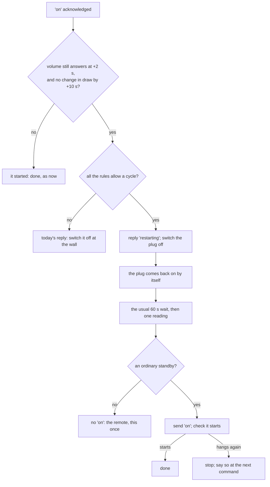

# The plug backstop: a design

**Status:** a design for review. None of it is built, and nothing here changes what the bridge
does yet. CLAUDE.md asks for any change to power handling to be agreed first: this is that step.

## What it's for

Now and then the projector hangs in standby. "On" is acknowledged, but it doesn't start, and the
bridge says so: "It didn't start. It might need switching off at the wall." Someone then has to
power-cycle it, with the plug's button or at the wall, or sometimes the remote gets it out.

The projector's mains already goes through a smart plug, which the bridge reads. The backstop would
let the bridge switch that plug too, so that "Hey Jarvis, projector on" still ends with the
projector on, a few minutes later, without anyone touching anything. The bridge stays primarily a
projector controller: it would use the plug only when the projector needs rebooting.

## What we know

From the bridge's log and the plug's readings, October to November 2026:

- **A hang can be told apart.** In all 5 hung "on"s the plug recorded (9 to 17 November), volume
  still answered 2 s after the "on", which is the bridge's check today. And the projector's draw
  didn't change at all in the 10 s after it. A real start always dips below 10 W within 2-3 s of a
  serial "on" (5.9-9.4 W). So far, every "on" the bridge sent and called a start really started.
- **A power-cycle cleared every hang it was tried on:**
  - 7 November: the plug off for about 30 s;
  - 8 and 9 November: the plug off for 2 minutes, until its `auto_on` timer;
  - 17 November: the projector unplugged for about 9 s.
- **After the power comes back,** the boot shows in the draw for 43-53 s. A remote "on" worked
  46 s after the power returned (17 November), and a serial "on" 1.5 to 5 minutes after (7 November).
  The bridge already waits before asking anything: 60 s on Nick's Pi (`X100_POWER_UP_QUIET_SECONDS`,
  300 s by default).
- **The hazards it must respect** (all in CLAUDE.md):
  - questions in the first 30-34 s of a boot hang it;
  - an "off" soon after a start hung it once;
  - after some power-ups its standby answers as if it were on (1 of 2 on 15 October), and whether
    a serial "on" is safe from there isn't known;
  - cutting the power while it's on is the ordinary wall-switch risk, and best avoided.

## What it would do

1. You say "projector on". The bridge sends "on", as now.
2. It checks, as now, that volume has stopped answering 2 s later. If volume still answers, it
   also waits for the plug: 10 s after the "on", no change in the draw. Both together mean a hang.
3. It answers you at once: "It's hung, so I'm restarting it at the wall. It'll come on in about
   three minutes."
4. It switches the plug off. The plug brings its own power back: after 2 minutes, by its
   `auto_on`, or sooner with a timer in the command, if the plug takes one (below).
5. When the power is back, the bridge does what it does after any cut: it waits 60 s, then takes
   one reading.
6. If the reading shows an ordinary standby, it sends "on" again, and checks the projector starts:
   volume stops answering, then the draw rises.
7. If it starts, that's the end. If it doesn't, the bridge stops there. No second power-cycle: it
   tells you at your next command.



## The rules

It never breaks these:

1. **Only after both signs of a hang, and only after the bridge's own "on".** Nothing else sets it
   off. A hang the remote finds can't be seen: the draw doesn't change when a press doesn't reach it.
2. **Never while the projector draws more than standby** (over 25 W), or has in the last 30 s. If
   the draw changes at any point before the cut (a start, a press of the remote), it doesn't cut.
3. **Never within 120 s of a start or an "off" that the draw showed.** A hung "on" isn't a start:
   the draw shows no reaction.
4. **At most once per hang.** If the "on" after a power-cycle hangs too, it stops.
5. **At most 2 power-cycles a day,** or another number set in bridge.env.
6. **The plug brings its own power back.** The bridge only ever switches it off. So a bridge that
   crashes or restarts mid-cycle still leaves the projector powered.
7. **After the power returns, the same wait and reading as after any cut.** "On" goes out only from
   an ordinary standby. From the standby that answers as if it were on, no "on": the remote, this
   once, as today.
8. **No fresh readings from the plug, or no way to switch it: no cycle,** and today's reply.
9. **Off unless `X100_PLUG_BACKSTOP=true`.** It ships switched off.

## What you'd hear

| When | Reply |
|---|---|
| A hang, and it's restarting | "It's hung, so I'm restarting it at the wall. It'll come on in about three minutes." |
| A command while it restarts | "It's restarting. Give it a couple of minutes." |
| At the next command, after a restart that didn't help | "I restarted it, but it still wouldn't start. It needs switching off at the wall." |
| A hang when it isn't allowed to cycle (the day's limit, say) | "It's hung again. Switch it off at the wall this time." |
| It worked | Nothing: the picture comes on. |

The listener hears from the bridge only in answer to a command. So it can't say "it's on now" when
the restart works, unless a later version adds that.

## What the log would show

```
plug: no change in its draw in the 10 s after the bridge's 'on' at 19:30:05 (12.1 W): the projector didn't react to it at all
backstop: the projector is hung (volume still answered at +2 s; no change in its draw by +10 s): switching its plug off, the 1st power-cycle today
the projector's plug has switched its power off: sending the projector nothing until it's back
the projector's plug has switched its power back on: leaving the projector alone until 19:33:16, as questions while it boots can hang it
plug: its power came back at 19:32:16, and it booted: its draw peaked at 18.9 W at +35 s, and was back under 14.5 W from +43 s
serial (backstop): power? on (10 ms) · input? no reply (621 ms) · volume? 6 (25 ms) · mute? off (27 ms)
serial (backstop): 'on' ok (13 ms)
plug: the projector came on: a dip to 8.1 W at 19:33:19, then 136 W 15 s later; 2 s after the bridge's 'on'
backstop: done: it came on 3.2 min after the hang was found
```

The standby period's line would end "ended by a power cut (the bridge's backstop)", and the daily
line would count the power-cycles, and how many worked.

## Switching the plug

Shelly's Gen2 documentation gives two ways to switch the plug over MQTT, through the broker on the
Pi. Both need a setting changed on the plug.

- **MQTT control** (`enable_control`). The plug takes `on`, `off` and `toggle` on
  `<prefix>/command/switch:0`. The documentation also shows a timer added (its example is "on,10"),
  though only on another topic. It can switch the plug, and nothing else.
- **RPC over MQTT** (`enable_rpc`). `Switch.Set` with `toggle_after` (a flip-back timer, in
  seconds) does it in one call, and replies (`was_on`). But the same channel takes any call:
  settings, reboots, firmware. So a broker login that can use it can change anything on the plug.

**Recommended: MQTT control.** It only switches. With the plug's own `auto_on`, the power comes back
after 2 minutes, whatever happens to the bridge. If the timer form works on the switch's topic, the
power could be off for 30 s instead, which cleared the hang on 7 November.

### What would change, all done by Nick (nobody else handles the passwords)

1. **On the plug:** turn on MQTT control, on its web page, with its admin password. RPC over MQTT
   stays off.
2. **In the broker:** a login for the bridge on the Pi's own listener (port 1884). It may publish
   to `x100-plug/command/switch:0` and nothing else. Anonymous clients there still only read.
   That's a change to `/etc/mosquitto/conf.d/x100.conf`, its access list and password file, and to
   `~/x100-mqtt-setup.sh`, which sets them up.
3. **In bridge.env:** the bridge's broker login, and `X100_PLUG_BACKSTOP=true`.

### To check on the plug first

Do these with the bridge stopped and the projector in standby. Each one is a power cut, so the
projector boots each time: leave it 5 minutes afterwards.

- `off` on `x100-plug/command/switch:0`: the plug's status shows its output off, and its `auto_on`
  brings it back after 2 minutes. Note what `source` it reports each time.
- `off,30`: whether the timer works on that topic.
- That a client without the bridge's login can't switch it.

## Building it

- **In the simulator:** a fake plug that cuts the simulated projector's power when told, and
  brings it back after its timer, reporting each change as the real one does.
- **Tests:** in `tests/test_power_quirks.py`, each hazard first shown, then shown prevented:
  - cutting the power while it's on, or just after a start;
  - questions or an "on" during the boot after the cycle;
  - a second cycle in the same hang;
  - the standby that answers as if it were on, after the cycle;
  - the bridge restarting mid-cycle;
  - no fresh readings from the plug;
  - the day's limit.
- **Its own log lines and replies,** as above, and their spoken clips.
- **Released switched off,** and turned on only after the current hang test ends, so the test isn't
  muddied by power-cycles.

## Not in this design

- **A voice command to restart it on request,** such as "Hey Jarvis, restart the projector".
- **Telling you when it's back on.**
- **Acting on a hang found any other way.**

## Questions for Nick

1. Should it be automatic, as above, or only when you ask? Or both?
2. MQTT control (only switching), rather than RPC over MQTT?
3. Off for 2 minutes (the plug's own `auto_on`), or 30 s, if the plug's timer works?
4. After the power-cycle, should it send "on" again by itself, or only bring the power back?
5. At most 2 power-cycles a day?
6. Turn it on once the current hang test ends, in about 2-3 weeks?
